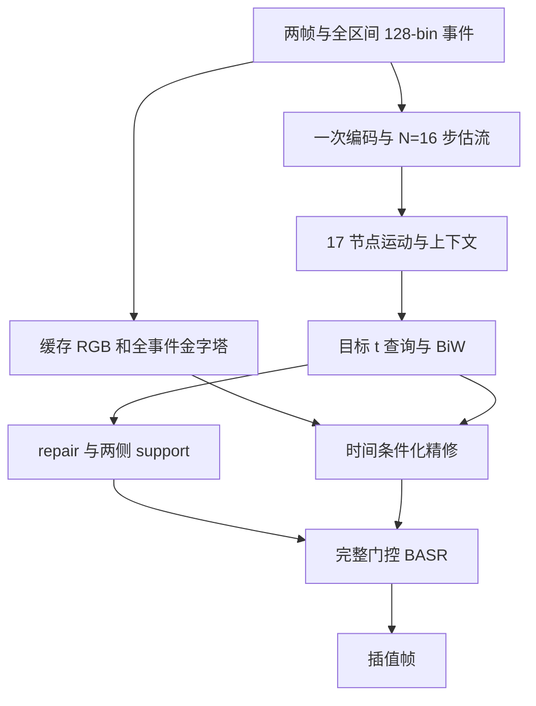

# 混合事件插帧模型：代码实现文档（修订版）

> 数据读取更新：本文保留原设计记录。当前实现按用户后续要求，GoPro 与 BS-ERGB 均采用 OF-AF BS-ERGB 式 images/events 目录、帧索引事件切片和裁剪后首末事件时间归一化；不读取外部时间戳文本，时间边界/单位等数据开关已从入口移除。当前数据接口、默认采样和评测规则以 README 第 3 节及 datasets/common.py 为准。

Nov 10, 2026 · @John · 本次修订：事件表示、BASR 与损失接口

> 本文是代码实现规范，所列新模块及超参数尚未经过完整训练验证。

## 0. 本次修订决定

事件输入统一为 **128×H×W**，沿用 OF-AF 的 **128 个时间 bin、16 个估流步骤、每组 8 个特征通道、17 个时间节点**。`voxel_bins=128`、`nb_of_flow=16`、`bins_per_flow=8`，与原始 OF-AF 的默认分组设置一致。事件表示、BASR 门控、Large 注意力头数与损失的其他修订继续保留。

| 修订项 | 最终约定 |
| --- | --- |
| 事件处理 | 沿用 OF-AF 的原始事件读取与时间双线性体素累积方法；新训练明确使用关键帧时间边界，生成全区间 128-bin 体素 |
| 事件适配器 | 删除完整体素按目标时刻硬切片、重采样的方案；改为全区间特征 + 目标时刻编码 + 查询上下文 |
| BASR 区域 | `repair = maximum(bad0, bad1)`；`support0 = bad1 * (1-bad0)`；`support1 = bad0 * (1-bad1)` |
| BASR 输出 | 对完整模块使用 `out = f_up + repair_gate * delta`；无支持或空修复区域时退回原主干 |
| Large 配置 | 两级 BASR 使用 4、2 个注意力头，并检查 `dim % num_heads == 0` |
| 光流辅助损失 | 按有效像素归一化；前向流使用源图像引导平滑，后向流使用目标真值引导平滑；有效性掩码停止梯度 |

新模型与官方 OF-AF 使用相同的 128-bin / 16 步输入和分组形状，但参数形状一致不代表前向行为相同。官方逐输出复现仍须使用原事件时间归一化、原查询、原 warp 和原精修头，并关闭新增模块。第 9、10 节分别给出实验划分和自检要求。

## 1. 目标与范围

要实现的是一个混合事件插帧模型：以 OF-AF 仓库为底，保留它的一次性光流估计（BiFEB）和双向 warp（BiW），把最后的卷积精修换成 CBMNet 的 Transformer 解码器，再接入 DSER++ 的 BASR。

模型保留 OF-AF 的调用方式；新训练的事件通道数保持为 128，默认返回预测张量，训练可显式请求辅助字典：

| 名称 | 形状 | 说明 |
| --- | --- | --- |
| `im0`、`im1` | (B, 3, H, W) | 两张关键帧，取值 \[0, 1\] |
| `event` | (B, 128, H, W) | 0→1 整个关键帧区间的事件体素，新训练与官方兼容模式均为 128 通道 |
| `interp_times` | (B, K) | K 个目标时刻，取值 (0, 1)；同一 batch 内各样本共用同一组时刻 |
| 默认输出 | (B, K, 3, H, W) | K 张插值帧；`return_aux=True` 时返回含 `pred`、`pred_ms`、`aux` 的字典 |

实现分五个阶段，每个阶段都能单独训练和评测：

| 阶段 | 内容 | 产出 |
| --- | --- | --- |
| P0 | 复现 OF-AF 和 CBMNet 的公开权重，做光流诊断 | 基线数字 |
| P1 | 固定 128-bin / 16 步与显式关键帧时间边界，分别验证 Query 与 warp 修正 | 新配置基线 B0 |
| P2 | 把精修头换成 CBMNet Transformer，输出改为残差 | 最小混合模型 |
| P3 | 掩码送入 Transformer，接入 BASR | 可见性引导的精修 |
| P4 | 光流辅助损失、相关残差修正、softmax splatting | 光流侧改进 |

以下内容不在范围内：

- 不移植 CBMNet 的光流网络 EIF-BiOFNet，也不需要它的 CUDA correlation 扩展。
- 不移植 DSER++ 的事件重建阶段和 E-PCD 对齐阶段。
- 不沿用 CBMNet 的数据格式（每个目标时刻一组 0t、t0、t1 体素）。

文中标为"建议值"的超参数没有经过实验验证，需要自己调。所有行号基于 2026-11-10 读取的 `main` 分支，提交号见第 2 节。

## 2. 参考仓库与关键文件

三个仓库都固定到下表的提交号。文件链接是该提交的永久链接，行号不会随仓库更新而漂移。

| 仓库 | 论文 | 提交 | 许可 | 在本项目中的角色 |
| --- | --- | --- | --- | --- |
| [Sudadaaaa/OF-AF](https://github.com/Sudadaaaa/OF-AF) | [One-Shot Flow, Any-Time Frame](https://openaccess.thecvf.com/content/CVPR2026/html/Fu_One-Shot_Flow_Any-Time_Frame_A_Bidirectional_Warping_Framework_for_Event-Based_CVPR_2026_paper.html)，CVPR 2026 | `f7791a6` | 没有顶层 LICENSE 文件 | 工程底座：数据、训练、BiFEB、BiW |
| [intelpro/CBMNet](https://github.com/intelpro/CBMNet) | Cross-Modal Asymmetric Bidirectional Motion Fields，CVPR 2023 | `248405c` | README 写明仅限研究与教育用途 | Transformer 解码器、损失函数 |
| [yuhan0802/DSER-pp](https://github.com/yuhan0802/DSER-pp) | [Asymmetric Refinement with the Event-based Reference](https://doi.org/10.1109/TCSVT.2026.3714455)，TCSVT 2026 | `786bd6d` | Apache-2.0 | BASR 模块、patch SSIM 损失 |

预训练权重：OF-AF 只发布了 BS-ERGB 权重，在 [Releases](https://github.com/Sudadaaaa/OF-AF/releases)。CBMNet 的三份权重（Ours、Ours-Large、Ours-Large BSERGB）和 DSER++ 的权重目录，链接分别在各自的 [README](https://github.com/intelpro/CBMNet#readme) 和 [README](https://github.com/yuhan0802/DSER-pp#readme) 里。

### OF-AF：底座，大部分原样保留

| 文件 | 内容 | 本项目中的处理 |
| --- | --- | --- |
| [models/model.py L7–59](https://github.com/Sudadaaaa/OF-AF/blob/f7791a6aad64cec8af37f0fb5d90002ace1a1a87/models/model.py#L7-L59) | `MyModel`：一次性循环（L36–44）和逐时刻循环（L46–58） | 改写为新的顶层模型 |
| [models/BiFEB.py L45–83](https://github.com/Sudadaaaa/OF-AF/blob/f7791a6aad64cec8af37f0fb5d90002ace1a1a87/models/BiFEB.py#L45-L83) | `BidirFlow`：单步双向光流估计 | 原样保留 |
| [models/BiFEB.py L35–42](https://github.com/Sudadaaaa/OF-AF/blob/f7791a6aad64cec8af37f0fb5d90002ace1a1a87/models/BiFEB.py#L35-L42) | `Query`：节点间插值，权重方向与直觉相反 | 用新的 `FlowQuery` 取代 |
| [models/BiW.py L23–61](https://github.com/Sudadaaaa/OF-AF/blob/f7791a6aad64cec8af37f0fb5d90002ace1a1a87/models/BiW.py#L23-L61) | `MaskGuideNet`：前向 splat、后向 warp、空洞掩码、差异掩码 | 改返回值，把掩码导出 |
| [models/BiW.py L64–84](https://github.com/Sudadaaaa/OF-AF/blob/f7791a6aad64cec8af37f0fb5d90002ace1a1a87/models/BiW.py#L64-L84) | `BiW`：两路融合，再用 `ResBlockIF` 精修 | 精修部分换成 Transformer 头 |
| [models/blocks.py L59–90](https://github.com/Sudadaaaa/OF-AF/blob/f7791a6aad64cec8af37f0fb5d90002ace1a1a87/models/blocks.py#L59-L90) | `BackwardWarp`：零光流时有半像素偏移 | 留作兼容模式，另写无偏移版本 |
| [models/encoder.py L26–65](https://github.com/Sudadaaaa/OF-AF/blob/f7791a6aad64cec8af37f0fb5d90002ace1a1a87/models/encoder.py#L26-L65) | `EventsEncoder`、`ImageEncoder` | 结构沿用；事件输入 bin 与估流步数由配置决定 |
| [models/softsplat.py L233](https://github.com/Sudadaaaa/OF-AF/blob/f7791a6aad64cec8af37f0fb5d90002ace1a1a87/models/softsplat.py#L233) | 前向 splat，依赖 cupy 和 CUDA | 原样保留 |
| [train\_model.py L35–84](https://github.com/Sudadaaaa/OF-AF/blob/f7791a6aad64cec8af37f0fb5d90002ace1a1a87/train_model.py#L35-L84) | 训练循环；损失在 L63–65，梯度裁剪在 L68 | 改损失和参数分组 |
| [datasets/gopro.py L15–79](https://github.com/Sudadaaaa/OF-AF/blob/f7791a6aad64cec8af37f0fb5d90002ace1a1a87/datasets/gopro.py#L15-L79)、[datasets/bsergb.py L14–75](https://github.com/Sudadaaaa/OF-AF/blob/f7791a6aad64cec8af37f0fb5d90002ace1a1a87/datasets/bsergb.py#L14-L75) | 两个训练集；数据根目录写死为 `/DATASSD1/...` | 加入目标时刻子采样，路径改成参数 |
| [datasets/\_\_init\_\_.py L7–20](https://github.com/Sudadaaaa/OF-AF/blob/f7791a6aad64cec8af37f0fb5d90002ace1a1a87/datasets/__init__.py#L7-L20) | 数据集选择；GoPro 训练 skip 固定为 31 | 改成多种 skip 混合 |
| [util/voxelization.py L27–85](https://github.com/Sudadaaaa/OF-AF/blob/f7791a6aad64cec8af37f0fb5d90002ace1a1a87/util/voxelization.py#L27-L85) | 事件体素化，时间方向双线性分配 | 原样保留 |
| [bsergb\_eval.py](https://github.com/Sudadaaaa/OF-AF/blob/f7791a6aad64cec8af37f0fb5d90002ace1a1a87/bsergb_eval.py) | BS-ERGB 评测；L84–89 把输入 pad 到 4 的倍数 | pad 改为 32 的倍数 |

### CBMNet：取解码器和损失

| 文件 | 内容 | 本项目中的处理 |
| --- | --- | --- |
| [ours.py L653–750](https://github.com/intelpro/CBMNet/blob/248405c313ce29f87ad42873df46792c76f55d1a/models/final_models/ours.py#L653-L750) | `Transformer`：查询构建（L691–706）、三级解码（L708–739）、三个尺度出图（L741–750） | 复制，把各输入通道数改成构造参数 |
| [ours.py L420–650](https://github.com/intelpro/CBMNet/blob/248405c313ce29f87ad42873df46792c76f55d1a/models/final_models/ours.py#L420-L650) | Restormer 组件：`LayerNorm`、`FeedForward`、`CrossAttention`、自注意力、`Upsample` | 原样复制 |
| [ours.py L385–413](https://github.com/intelpro/CBMNet/blob/248405c313ce29f87ad42873df46792c76f55d1a/models/final_models/ours.py#L385-L413) | `frame_encoder`、`event_encoder`，各输出三个尺度 | 沿用结构，事件输入通道按 6.4 改为 bins |
| [ours.py L820–847](https://github.com/intelpro/CBMNet/blob/248405c313ce29f87ad42873df46792c76f55d1a/models/final_models/ours.py#L820-L847) | `synthesis`：特征金字塔、warp、拼接后送入 Transformer | 输入组织方式的参考 |
| [ours.py L346–362](https://github.com/intelpro/CBMNet/blob/248405c313ce29f87ad42873df46792c76f55d1a/models/final_models/ours.py#L346-L362) | I-BiOF：warp、特征归一化、相关、残差光流 | P4 相关修正的参考 |
| [submodules.py](https://github.com/intelpro/CBMNet/blob/248405c313ce29f87ad42873df46792c76f55d1a/models/final_models/submodules.py) | `conv3x3`、`conv_resblock_one` 等卷积辅助函数 | 原样复制 |
| [loss\_handler.py L30–64](https://github.com/intelpro/CBMNet/blob/248405c313ce29f87ad42873df46792c76f55d1a/models/loss_handler.py#L30-L64) | 多尺度图像损失、光流光度损失、Charbonnier | 移植到新的损失文件 |
| [utils/flow\_utils.py L69–85](https://github.com/intelpro/CBMNet/blob/248405c313ce29f87ad42873df46792c76f55d1a/utils/flow_utils.py#L69-L85) | `cal_grad2_error`：边缘感知的二阶平滑损失 | 移植 |
| [model\_manager.py L71–85](https://github.com/intelpro/CBMNet/blob/248405c313ce29f87ad42873df46792c76f55d1a/models/model_manager.py#L71-L85) | 用 2×2 平均池化生成多尺度真值；损失权重在 L15 | 移植 |
| [train.py](https://github.com/intelpro/CBMNet/blob/248405c313ce29f87ad42873df46792c76f55d1a/train.py) | 训练脚本，不能直接运行（见第 10 节） | 只作参考，不复用 |

### DSER-pp：取 BASR

| 文件 | 内容 | 本项目中的处理 |
| --- | --- | --- |
| [model/trans\_sys.py L254–383](https://github.com/yuhan0802/DSER-pp/blob/786bd6d0dbf08eac1484f78044952d24c08d262b/model/trans_sys.py#L254-L383) | CBMNet 的 `Transformer` 加上 BASR；插入点在 L346–350 和 L361–365 | P3 的合并模板 |
| [model/patch\_attention.py L46–121](https://github.com/yuhan0802/DSER-pp/blob/786bd6d0dbf08eac1484f78044952d24c08d262b/model/patch_attention.py#L46-L121) | `TransformerBlock`（带掩码的 patch 交叉注意力）、`DetailsSup`（即 BASR） | 复制，改键特征来源和空掩码处理 |
| [model/position\_encoding.py](https://github.com/yuhan0802/DSER-pp/blob/786bd6d0dbf08eac1484f78044952d24c08d262b/model/position_encoding.py) | 正弦位置编码 | 原样复制 |
| [util/utils\_func.py L385–464](https://github.com/yuhan0802/DSER-pp/blob/786bd6d0dbf08eac1484f78044952d24c08d262b/util/utils_func.py#L385-L464) | 差分图分 patch、阈值筛选、`mask_reverse` | 参考；本项目改用空洞掩码生成选择掩码 |
| [model/ourNet.py L56–65](https://github.com/yuhan0802/DSER-pp/blob/786bd6d0dbf08eac1484f78044952d24c08d262b/model/ourNet.py#L56-L65) | 选择掩码如何生成并传给解码器 | 参考 |
| [model/loss.py L114–213](https://github.com/yuhan0802/DSER-pp/blob/786bd6d0dbf08eac1484f78044952d24c08d262b/model/loss.py#L114-L213) | 带 patch 掩码的 SSIM | 移植为结构一致性损失 |

## 3. 总体架构与数据流



光流和上下文每对关键帧只算一次，缓存为 N+1 个时间节点（默认 N=16，共 17 节点）；之后每个目标时刻只做查询、双向 warp 和精修。BiW 接收关键帧、查询光流和上下文；精修头接收缓存金字塔、时间条件事件特征及粗融合结果。

各模块对应的文件和运行频率如下，文件清单见第 4 节。

| 模块 | 文件 | 运行频率 | 实现说明 |
| --- | --- | --- | --- |
| 编码器 | `models/encoder.py` | 每对关键帧一次 | 原样保留 |
| BiFEB | `models/BiFEB.py` | 每对关键帧一次，内部循环 N 步 | 原样保留 |
| Flow Query | `models/query.py` | 每个目标时刻 | 6.2 |
| 相关残差修正（P4，可选） | `models/flow_corr.py` | 每个目标时刻 | 7.2 |
| BiW | `models/BiW.py` | 每个目标时刻 | 6.3 |
| 事件特征适配 | `models/event_adapter.py` | 全区间编码每对关键帧一次，条件化每个目标时刻一次 | 6.4 |
| 精修头 | `models/refine_head.py`、`models/cbm_modules.py` | 每个目标时刻 | 6.5 |
| BASR（P3，可选） | `models/basr.py` | 每个目标时刻，解码器内调用两次 | 7.1 |

## 4. 工程结构与文件清单

从 OF-AF 的提交 `f7791a6` 建分支，新增 8 个文件、修改 8 个文件，其余不动。

```
OF-AF/
├── models/
│   ├── model.py          # 改：顶层模型 HybridModel
│   ├── BiFEB.py          # 不动（其中的 Query 类不再使用）
│   ├── BiW.py            # 改：导出掩码，精修头可切换
│   ├── blocks.py         # 改：新增无偏移的 warp
│   ├── encoder.py        # 不动
│   ├── softsplat.py      # 不动
│   ├── query.py          # 新：FlowQuery
│   ├── cbm_modules.py    # 新：从 CBMNet 复制的卷积辅助、Restormer 组件、两个编码器、Transformer
│   ├── event_adapter.py  # 新：全区间体素编码，目标时刻与上下文条件化
│   ├── refine_head.py    # 新：Transformer 精修头及其输入组装
│   ├── basr.py           # 新（P3）：从 DSER-pp 复制的 BASR
│   ├── flow_corr.py      # 新（P4）：相关残差修正
│   └── losses.py         # 新：全部损失
├── datasets/
│   ├── __init__.py       # 改：多种 skip 混合，数据路径参数化
│   ├── gopro.py          # 改：目标时刻子采样
│   └── bsergb.py         # 改：目标时刻子采样
├── train_model.py        # 改：损失、参数分组、新增开关
├── bsergb_eval.py        # 改：按 BASR 开关补边、辅助返回值与 LPIPS 约定
└── tests/
    └── test_sanity.py    # 新：第 10 节的自检
```

所有可选模块分别设置开关。新训练配置与官方复现配置明确分开；关闭新增模块不等于自动恢复官方输入形状和数据语义。

| 开关 | 取值 | 新训练默认值 | 作用 |
| --- | --- | --- | --- |
| `--voxel_bins` | 正整数 | 128 | 全区间体素的时间通道数 |
| `--nb_of_flow` | 正整数 | 16 | 估流步骤 N；要求 `voxel_bins % nb_of_flow == 0` |
| `--refine` | `resblock` / `transformer` | `transformer` | 精修头类型 |
| `--unit_dim` | 32 / 44 | 32 | CBMNet 精修宽度；44 为 Large 宽度 |
| `--legacy_query` | 开 / 关 | 关 | 原查询权重；逐输出复现官方模型时打开 |
| `--legacy_warp` | 开 / 关 | 关 | 原半像素偏移 warp；逐输出复现时打开 |
| `--legacy_event_time` | 开 / 关 | 关 | 使用读取事件的首末时间归一化；官方数据复现时打开 |
| `--legacy_lpips` | 开 / 关 | 关 | 保留源脚本未显式归一化的 LPIPS 调用，仅用于历史指标核对 |
| `--mask_in_refine` | 开 / 关 | 关 | 四张诊断掩码送入精修头 |
| `--basr` | 开 / 关 | 关 | 开启完整门控残差 BASR |
| `--basr_heads` | 两个正整数 | 4 2 | 两级 BASR 头数，适用于 u=32 和 u=44 |
| `--basr_keys` | `warped` | `warped` | 默认只实现目标网格上的对齐参考；`raw` 须另实现掩码坐标映射后再开放 |
| `--flow_corr` | 开 / 关 | 关 | 查询后后向流残差修正 |
| `--splat_metric` | 开 / 关 | 关 | 可学习 splatting 度量，当前必须同时启用前向光度辅助监督 |
| `--num_targets` | 正整数 | 4 | 实际取 `min(num_targets, 可用目标帧数)` |
| `--w_flow`、`--w_ps` | 非负浮点数 | 0 | 光流与区域结构辅助损失权重 |

构造时检查 N 为正、bin 数可整除 N、两级 BASR 嵌入维度可整除对应头数。新训练与官方复现均使用 `--voxel_bins 128 --nb_of_flow 16`；是否复现旧行为由相应 legacy 开关决定。

复制代码时有四处要处理：

- CBMNet 的 `ours.py` 第 6 行导入了 CUDA correlation 扩展，复制时删掉这一行。
- `ours.py` 靠 `from ...submodules import *` 拿到 `F`（即 `torch.nn.functional`），合并到 `cbm_modules.py` 后要显式导入。
- 不要复制 CBMNet 的 `bwarp` 和 `warp`，它们写死了 `.cuda()`。所有 warp 统一走本项目 `blocks.py` 里的实现。
- DSER-pp 的 `patch_attention.py` 用 `from model.position_encoding import ...`，合并到 `basr.py` 后改成本地导入。

## 5. 张量接口约定

光流一律以所在分辨率的像素为单位，通道 0 是 x 方向。后向光流指目标帧每个像素到源帧的位移，供 warp 用；前向光流指源帧每个像素到目标帧的位移，供 splat 用。

下文记 h=H/4、w=W/4、N=`nb_of_flow`。新训练默认 N=16，节点 k 对应模型查询时刻 k/N，k=0…N。保留 OF-AF 的先全通道卷积、再按通道分组的编码结构；这些分组是学习得到的时序特征，不宣称每组仅包含一个原始物理时间片的事件。

### 一次性阶段的输出

六个节点列表的长度均为 N+1，默认新训练与官方配置均为 17。输入体素的 128 表示时间 bin 数；编码后特征的 128 来自 `base_channel*4`，两者含义不同。

| 名称 | 形状 | 含义 |
| --- | --- | --- |
| `if0_1`、`if1_1` | (B,32,H,W) | OF-AF 全分辨率图像特征 |
| `if0_4`、`if1_4` | (B,128,h,w) | OF-AF 四分之一尺度图像特征 |
| `efs01` | (B,N,128,h,w) | N 组学习得到的事件特征；新配置为 (B,16,128,h,w) |
| `flows0t[k]` | (B,2,h,w) | F(0→k/N)，第 0 项为零 |
| `flowst0[k]` | (B,2,h,w) | F(k/N→0)，第 0 项为零 |
| `ctxst0[k]` | (B,128,h,w) | I0 分支查询上下文，第 0 项为 `if0_4` |
| `flows1t[k]`、`flowst1[k]`、`ctxst1[k]` | 同上 | I1 分支列表按全局时间升序存放，第 N 项对应 t=1；该项光流为零 |
| `event_global[s]` | (B,u×2^s,H/2^s,W/2^s) | 全区间事件适配特征，s=0,1,2；跨目标时刻复用 |

构造器必须执行 `assert voxel_bins % nb_of_flow == 0`。默认 128/16 得到每组 8 个特征通道；`EventsEncoder` 仍先混合全区间信息，再按通道分组，不能将这 8 个特征通道等同于只含独立原始事件的 8 个 bin。

### 逐时刻阶段的中间量

| 名称 | 形状 | 含义 |
| --- | --- | --- |
| `f_0t`、`f_1t` | (B, 2, h, w) | 查询得到的前向光流 F(0→t)、F(1→t) |
| `f_t0`、`f_t1` | (B, 2, h, w) | 查询得到的后向光流 F(t→0)、F(t→1) |
| `ctx0`、`ctx1` | (B, 128, h, w) | t 时刻的上下文 θ⁰、θ¹ |
| `imt0`、`imt1` | (B, 3, H, W) | `MaskGuideNet` 修正后的后向 warp 帧 |
| `im0t`、`im1t` | (B, 3, H, W) | 前向 splat 帧 |
| `hole0`、`hole1` | (B,1,h,w) | 从覆盖量阈值化得到的诊断空洞掩码，严格为 0/1；不是可见性真值 |
| `coverage0`、`coverage1` | (B,1,H,W) | 全分辨率前向覆盖量，供光度有效性判定使用 |
| `in_bounds0`、`in_bounds1` | (B,1,H,W) | 后向采样坐标位于源图像有效范围内的掩码 |
| `diff0`、`diff1` | (B, 1, H, W) | 差异掩码，取值 0 或 1；前向与后向结果的绝对差超过 0.1 |
| `mask0`、`mask1` | (B, 1, H, W) | 精修后的空洞掩码上采样再加差异掩码，即 OF-AF 原来的 `Mask0t` |
| `fuse` | (B, 3, H, W) | 粗融合帧 |
| 输出 | 三个张量 | 全分辨率、1/2、1/4 三个尺度的结果，训练时都受监督，推理只取第一个 |

### 尺度换算

查询出的光流在 1/4 分辨率。换到尺度 s（s = 0 全分辨率，1 半分辨率，2 四分之一）时，空间放大几倍，数值也乘几倍：

```python
def flow_to_scale(f_quarter, s):
    r = 4 // (2 ** s)          # s=0 -> 4, s=1 -> 2, s=2 -> 1
    if r == 1:
        return f_quarter
    return F.interpolate(f_quarter, scale_factor=r, mode='bilinear', align_corners=False) * r
```

### warp 约定

默认使用下面的无偏移实现。零光流时输出与输入逐像素相等。

```python
def backwarp(img, flow):
    # img: (B,C,H,W)；flow: (B,2,H,W)，单位是 img 所在分辨率的像素
    B, _, H, W = img.shape
    ys, xs = torch.meshgrid(
        torch.arange(H, device=img.device, dtype=img.dtype),
        torch.arange(W, device=img.device, dtype=img.dtype), indexing='ij')
    gx = 2.0 * (xs[None] + flow[:, 0]) / max(W - 1, 1) - 1.0
    gy = 2.0 * (ys[None] + flow[:, 1]) / max(H - 1, 1) - 1.0
    grid = torch.stack((gx, gy), dim=-1)
    return F.grid_sample(img, grid, mode='bilinear', padding_mode='zeros', align_corners=True)
```

OF-AF 原来的 `BackwardWarp` 把坐标归一化为 `2 * (x / W - 0.5)`，再以 `align_corners=False` 采样。这样零光流时采到的是 x − 0.5 的位置，网络学到的光流里带着这半个像素的补偿。两种实现不能混用：加载官方权重时开 `--legacy_warp`，从头训练时用新实现。

前向 splat 不改，继续调用 `softsplat(src, flow, None, 'avg')`，源像素 x 落到 x + flow。

### 时间与尺寸

- t 从 I0 起算，取值 (0,1)。令 idx=N×t，i=floor(idx) 并限制在 0…N−1，λ=idx−i。新配置使用 N=16。
- 训练裁剪为 256×256。
- 测试时把 H、W 补到 32 的倍数，输出再裁回。BASR 在 1/4 尺度用 8×8 的 patch，在 1/2 尺度用 16×16 的 patch，折算到全分辨率都是 32。不开 BASR 时补到 4 的倍数即可。

## 6. 核心模块实现（P1–P2）

这一节的五个模块写完，就得到最小混合模型：OF-AF 的光流和 BiW，加 CBMNet 的 Transformer 精修头。

### 6.1 顶层前向：`models/model.py`

BiFEB 的循环与六个列表构建方式沿用 OF-AF，循环上限使用 N。新模块仅在对应配置启用时构造，`resblock` 模式不调用不存在的 `refine_head`。默认返回张量以兼容原评测调用；训练显式设置 `return_aux=True`。

```python
def forward(self, im0, im1, event, interp_times, return_aux=False):
    assert event.shape[1] == self.voxel_bins
    assert torch.allclose(interp_times, interp_times[:1].expand_as(interp_times))
    efs01 = self.events_encoder(im0, im1, event)  # (B,N,128,h,w)
    if0_1, if0_4 = self.im_encoder(im0)
    if1_1, if1_4 = self.im_encoder(im1)
    knots = self.run_bifeb(if0_4, if1_4, efs01)   # 每个列表长度 N+1

    if self.refine == 'transformer':
        pyr = self.refine_head.encode_frames(im0, im1)
        event_global = self.event_adapter.encode_events(event)

    predictions, predictions_ms, auxiliary = [], [], []
    for j in range(interp_times.shape[1]):
        t = interp_times[0, j]
        q_raw = self.query(knots, t)
        q = self.flow_corr(q_raw, if0_4, if1_4) if self.flow_corr is not None else q_raw
        w = self.biw(im0, im1, t, q, src_feat0=if0_4, src_feat1=if1_4)
        if self.refine == 'resblock':
            ms = [self.biw.refine_resblock(w, q, if0_1, if1_1)]
        else:
            ev = self.event_adapter(event_global, t, q['ctx0'], q['ctx1'])
            ms = self.refine_head(pyr, q, w, ev)
        predictions.append(ms[0])
        if return_aux:
            predictions_ms.append(ms)
            auxiliary.append(dict(q_raw=q_raw, q=q, w=w))

    pred = torch.stack(predictions, 1)
    if not return_aux:
        return pred
    return dict(pred=pred, pred_ms=predictions_ms, aux=auxiliary)
```

训练入口使用 `out = model(..., return_aux=True)`；原评测入口可继续使用 `pred = model(...)`。若开启 splat 度量，BiW 还需接收源帧四分之一特征，具体见 7.3；不得把 t 网格上下文当作源特征。

### 6.2 Flow Query：`models/query.py`

原仓库的六个查询量里，只有 `f_0t` 的插值权重是正常方向，其余五个反了（`model.py` L53–56、`BiFEB.py` L40–41）。新实现统一用正常方向，并保留一个逐项复现原行为的兼容模式。

```python
class FlowQuery(nn.Module):
    def __init__(self, n_seg=16, legacy=False):
        super().__init__()
        assert n_seg > 0
        self.n, self.legacy = n_seg, legacy

    def forward(self, knots, t):
        target = float(t)
        if not 0.0 < target < 1.0:
            raise ValueError("interp time must lie in (0,1)")
        idx = target * self.n
        i = min(max(int(idx), 0), self.n - 1)
        lam = idx - i
        nat = lambda lst: lst[i] * (1 - lam) + lst[i + 1] * lam      # λ=0 返回节点 i
        old = lambda lst: lst[i] * lam + lst[i + 1] * (1 - lam)      # 原仓库的写法
        g = old if self.legacy else nat
        return dict(
            f_0t=nat(knots['flows0t']),
            f_1t=g(knots['flows1t']),
            f_t0=g(knots['flowst0']),
            f_t1=g(knots['flowst1']),
            ctx0=g(knots['ctxst0']),
            ctx1=g(knots['ctxst1']))
```

正常方向下，内部节点 t=k/N 返回第 k 项。t 趋近 0 时 F(0→t) 与 F(t→0) 趋近零；I1 分支在 t 趋近 1 时趋近零。兼容模式在整节点处，除 `f_0t` 外的五项按原调用返回第 k+1 项。要逐输出复现官方权重，使用 N=16 和兼容模式；新训练使用 N=16 与正常模式。

### 6.3 BiW 的改动：`models/BiW.py`

改动有三处，网络结构和参数名都不变，所以官方权重仍能加载。

1. `MaskGuideNet.forward` 改为返回字典。在 refblock 修改空洞提示前保留内部 `hole_raw`；另从 `sum` splat 的覆盖量计算严格二值诊断 `hole`。旧内部数值保留用于官方逐输出兼容。
2. `BiW.forward` 只做到融合为止，返回粗融合帧和两路的中间结果。
3. 原 L79–84 的 `ResBlockIF` 精修挪到单独的方法 `refine_resblock`，仅在 `--refine resblock` 时调用。

```python
# MaskGuideNet.forward 的返回值
return dict(imt=imt0, im_fwd=im0t, mask=Mask0t,
            hole=hole_binary, hole_raw=hole_raw, diff=diff_mask,
            coverage=coverage_full, in_bounds=in_bounds_full)

# BiW.forward
def forward(self, im0, im1, t, q, src_feat0=None, src_feat1=None):
    a = self.fuse_warp(im0, im1, q['f_0t'], q['f_t0'], q['ctx0'], q['ctx1'],
                       src_feat=src_feat0)  # I0 一路
    b = self.fuse_warp(im1, im0, q['f_1t'], q['f_t1'], q['ctx1'], q['ctx0'],
                       src_feat=src_feat1)  # I1 一路，权重共享
    m = torch.softmax(torch.cat([(1 - a['mask']) * (1 - t), (1 - b['mask']) * t], 1), 1)[:, :1]
    fuse = a['imt'] * m + (1 - m) * b['imt']
    return dict(fuse=fuse, blend=m, a=a, b=b)
```

`MaskGuideNet.forward` 增加可选参数 `src_feat=None`；仅度量开关打开时使用它，关闭时不改变原计算。`MaskGuideNet` 与 `BidirFlow` 的 warp 统一由 `--legacy_warp` 选择。诊断和损失额外量的定义如下，不引入可学习参数：

```python
coverage_quarter = softsplat(ones_quarter, flow0t, None, 'sum')
hole_binary = (coverage_quarter <= 1e-6).to(flow0t.dtype)
coverage_full = softsplat(torch.ones_like(im0[:, :1]), Flow0t, None, 'sum')
```

`ones_quarter` 的形状为 (B,1,h,w)。`in_bounds_full` 根据 `x+Flowt0_x`、`y+Flowt0_y` 是否分别落在 `[0,W−1]`、`[0,H−1]` 内生成，并与实际 backwarp 使用同一坐标约定。原 `avg` splat 对 ones 的结果受分母 epsilon 影响，`1-result` 不能直接宣称严格二值。

官方模式保留原有内部 hole 与 `Mask0t` 计算；新增二值 hole 仅供诊断、BASR 和辅助损失使用，不替换官方路径内部数值。

### 6.4 事件特征适配：`models/event_adapter.py`

本节按本次修订采用全区间 **128×H×W** 体素。沿用 OF-AF 的读取与体素累积方法，但取消“完整体素硬切成 0→t 与 t→1，再压到 16 bin”的近似。精修分支直接接收完整事件特征，通过 t 与查询上下文条件化。接口通道与 CBMNet 解码器保持一致，特征语义是目标时刻条件化的全区间表示，不再宣称是两段重新体素化的事件。

#### 6.4.1 读取与体素化

1. 读取两张关键帧间的原始事件；图像与事件使用同一空间裁剪和增强。
2. 新训练显式设置 `start_time=τ0`、`end_time=τ1`，其中 τ0、τ1 是关键帧时间戳。裁剪后仍使用同一时间边界，不由裁剪区域内首末事件重新定义时间轴。
3. 调用 OF-AF 的 `to_voxel_grid(..., nb_of_time_bins=128)`，沿用其空间/时间双线性权重与极性累积。事件时间坐标为 `127*(τ−τ0)/(τ1−τ0)`。
4. 原始事件为空时返回全零 128-bin 体素；显式时间跨度必须大于零。只有一个事件时也使用关键帧跨度，不以该事件自身首末时间作除数。
5. 若暂时缺少图像时间戳，只有在数据集帧率和同步关系已知时才能据此构造时间边界，并记录该假设；不得把事件首末时间静默当成图像时间。

```python
def voxelize_interval(features, height, width, tau0, tau1, bins=128):
    if tau1 <= tau0:
        raise ValueError('keyframe timestamps must increase')
    if len(features) == 0:
        return torch.zeros(bins, height, width, dtype=torch.float32)
    # features 按 OF-AF 定义为 x,y,t,p，且已筛选到该关键帧区间。
    seq = EventSequence(features, height, width, start_time=tau0, end_time=tau1)
    return to_voxel_grid(seq, nb_of_time_bins=bins)
```

以上使用 OF-AF 既有类和累积算法。`--legacy_event_time` 才恢复首末事件归一化，供官方 128-bin 权重对照使用。128-bin 表示仍需正确的时间边界；bin 数保持不变并不会自动修复时间轴。

#### 6.4.2 全区间编码与目标时刻条件化

事件编码每对关键帧只执行一次。`event_encoder` 先产生 `[u/2,u,2u]` 通道，再投影到解码器需要的 `[u,2u,4u]`。目标时刻使用连续的 `[t,1−t]` 编码，四分之一尺度融合 `ctx0`、`ctx1`。

```python
class EventAdapter(nn.Module):
    def __init__(self, unit_dim=32, ctx_ch=128, bins=128):
        super().__init__()
        u = unit_dim
        self.bins = bins
        self.enc = event_encoder(bins, u // 2)
        self.proj = nn.ModuleList([
            nn.Conv2d(c, 2*c, 1) for c in (u//2, u, 2*u)
        ])
        self.time_proj = nn.ModuleList([
            nn.Conv2d(2, c, 1) for c in (u, 2*u, 4*u)
        ])
        self.fuse = nn.Conv2d(4*u + 2*ctx_ch, 4*u, 1)

    def encode_events(self, event):
        assert event.shape[1] == self.bins
        return [proj(feat) for proj, feat in zip(self.proj, self.enc(event))]

    def forward(self, global_feats, t, ctx0, ctx1):
        batch = ctx0.shape[0]
        t = torch.as_tensor(t, device=ctx0.device, dtype=ctx0.dtype)
        code = torch.stack((t, 1-t)).reshape(1, 2, 1, 1)
        code = code.expand(batch, -1, -1, -1)
        ev = [feat + proj(code) for feat, proj in zip(global_feats, self.time_proj)]
        ev[2] = self.fuse(torch.cat((ev[2], ctx0, ctx1), 1))
        return ev
```

该适配器是新设计，不是原 CBMNet 事件输入的等价变换。其优点是无需猜测切分 bin，也没有整数切点导致的阶跃；最终输出的时间连续性仍需连同 Query、warp 和掩码一起检查。官方 CBMNet 的 16 通道事件编码首层与本模块输入形状不同，加载预训练参数时必须过滤该层。

### 6.5 Transformer 精修头：`models/refine_head.py`

精修头由 CBMNet 的 `frame_encoder` 和 `Transformer` 组成，输出是加在粗融合帧上的残差。记 u = `unit_dim`，U = 2u，E 为额外输入的通道数。

每个尺度 s 的三组输入如下，通道数按 u = 32 列出：

| 输入 | 组成 | 通道（s = 0, 1, 2） |
| --- | --- | --- |
| `frame_feature[s]` | 两张关键帧的 `frame_encoder` 特征拼接 | 16、32、64 |
| `event_feature[s]` | 6.4 的输出 | 32、64、128 |
| `warped_feature[s]` | I0 的特征与图像按 F(t→0) warp，I1 的按 F(t→1) warp，再拼上额外输入 | 22+E、38+E、70+E |

事件特征沿用第 6.4 节规定的全区间条件化语义。额外输入默认只有粗融合帧（E = 3）。打开 `--mask_in_refine` 后再加 `hole0`、`hole1`、`diff0`、`diff1` 四张掩码（E = 7）。各量换到尺度 s 的方式：

- 图像和粗融合帧：双线性下采样。
- 光流：第 5 节的 `flow_to_scale`。
- `hole`：原生在 1/4 尺度，往上用最近邻上采样。
- `diff`：原生在全分辨率，往下用平均池化。

```python
def forward(self, pyr, q, w, ev):
    frame_feature, warped_feature, fuse_ms = [], [], []
    for s in range(3):
        ft0, ft1 = flow_to_scale(q['f_t0'], s), flow_to_scale(q['f_t1'], s)
        w0 = self.warp(torch.cat((pyr['f0'][s], pyr['im0'][s]), 1), ft0)
        w1 = self.warp(torch.cat((pyr['f1'][s], pyr['im1'][s]), 1), ft1)
        extra = self.extras_at_scale(w, s)                   # E 个通道，第一项是粗融合帧
        fuse_ms.append(extra[:, :3])
        warped_feature.append(torch.cat((w0, w1, extra), 1))
        frame_feature.append(torch.cat((pyr['f0'][s], pyr['f1'][s]), 1))
    basr_data = None
    if self.use_basr:
        # 从 pyr 与 q 重新取出仅含图像特征的对齐参考，去掉 RGB 和 extra 通道。
        ref0 = [self.warp(pyr['f0'][s], flow_to_scale(q['f_t0'], s)) for s in range(3)]
        ref1 = [self.warp(pyr['f1'][s], flow_to_scale(q['f_t1'], s)) for s in range(3)]
        basr_data = dict(ref0=ref0, ref1=ref1, masks=make_basr_masks(w))
    res = self.transformer(ev, frame_feature, warped_feature, basr_data=basr_data)
    return [fuse_ms[s] + res[s] for s in range(3)]
```

P2 相对 CBMNet 的 `Transformer` 需要修改以下四个输入卷积及残差输出初始化；其 `forward` 增加可选 `basr_data=None`。P3 再按 7.1 增加完整 BASR 门控与两处解码插入点。

| 层（`ours.py` 行号） | 原输入通道 | 新输入通道 |
| --- | --- | --- |
| `enc_conv0`（L694） | U + 6 | U + 6 + E |
| `build_kv0_warp`（L671） | 3U + 6 | 3U + 6 + E |
| `build_kv1_warp`（L672） | 1.5U + 6 | 1.5U + 6 + E |
| `build_kv2_warp`（L673） | 0.75U + 6 | 0.75U + 6 + E |

还有三点和原实现不同：

- `last_conv0`、`last_conv1`、`last_conv2` 的权重和偏置初始化为零，训练开始时输出恰好等于粗融合帧。
- 去掉原 L846 的 `clamp`。训练时不截断，评测时再截断到 \[0, 1\]。
- 关键帧特征和图像金字塔在 `encode_frames` 里算一次，所有目标时刻共用。

可选：形状一致的层可以从 CBMNet 的 `ours_weight.pth`（u = 32）初始化，按键名与形状过滤 `transformer.`、`encoder_f.`、`encoder_e.` 对应参数，上表四个卷积、三个输出卷积，以及事件首层形状不一致的参数跳过；`strict=False` 本身不会忽略同名参数的形状冲突。这份权重是在直接回归 RGB 的设定下训练的，效果需要实测。

## 7. 进阶模块（P3–P4）

这三个模块都是在第 6 节的模型上做加法，各有独立开关。其中 7.1 的掩码设计和 7.2、7.3 是本项目新提出的做法，没有现成实验支撑。

### 7.1 BASR：`models/basr.py`

沿用 DSER++ 的 patch 交叉注意力与两级解码插入位置，但重新定义掩码及整个模块的残差行为。以目标网格上已对齐的参考特征作为 K/V；Query 来自当前解码特征。

#### 7.1.1 修复区域与支持来源

空洞表示投影覆盖不足，差异表示两类估计不一致，均为可靠性线索，不直接等价于真实遮挡。

```python
def make_basr_masks(w):
    size = w['fuse'].shape[-2:]
    up = lambda m: F.interpolate(m, size=size, mode='nearest')
    bad0 = torch.maximum(up(w['a']['hole']), w['a']['diff']).detach()
    bad1 = torch.maximum(up(w['b']['hole']), w['b']['diff']).detach()

    # 先排除后向采样越界，再生成二值诊断量。
    bad0 = torch.maximum(bad0, 1-w['a']['in_bounds']).clamp(0, 1)
    bad1 = torch.maximum(bad1, 1-w['b']['in_bounds']).clamp(0, 1)
    repair = torch.maximum(bad0, bad1)
    support0 = bad1 * (1-bad0)
    support1 = bad0 * (1-bad1)

    # 两侧都不可靠时不从端点强制检索，由原合成主干承担重建。
    available = ((support0 + support1) > 0).to(repair.dtype)
    repair_gate = repair * available
    return dict(repair=repair, support0=support0,
                support1=support1, repair_gate=repair_gate)
```

| bad0 | bad1 | repair | support0 | support1 | 完整 BASR 行为 |
| --- | --- | --- | --- | --- | --- |
| 0 | 0 | 0 | 0 | 0 | 保留主干，不补偿 |
| 0 | 1 | 1 | 1 | 0 | 允许从 I0 的可靠位置补偿 |
| 1 | 0 | 1 | 0 | 1 | 允许从 I1 的可靠位置补偿 |
| 1 | 1 | 1 | 0 | 0 | 保留主干，不强制读取错误端点纹理 |

默认 `warped` 参考与这些掩码都位于目标网格。`raw` 参考属于端点网格，在实现掩码的几何映射与遮挡处理前不开放该开关。新规则已明确指定来源，不再调用 `mask_reverse`。

Query gate 控制哪些目标位置能被改动；Key mask 控制哪些参考位置能提供信息。不得把来源掩码当成已限制全部 Query 的证据。

#### 7.1.2 空 Key 的安全注意力

原实现对全部 Key 加相同的 −100 不会变成均匀分布，因为 `softmax(z−100)=softmax(z)`。下面的安全方式为无有效 Key 的样本临时开放一个占位 Key，避免全 −inf 的 softmax，最终在输出投影和 MLP 之后把该来源输出置零。

```python
def safe_key_attention(logits, values, key_valid):
    # logits: (B,heads,Nq,Nk); values: (B,heads,Nk,d)
    # key_valid: (B,Nk), bool；调用者应保证 Nk>0。
    has_key = key_valid.any(dim=-1)
    safe_valid = key_valid.clone()
    safe_valid[~has_key, 0] = True
    allowed = safe_valid[:, None, None, :]
    weights = logits.masked_fill(~allowed, float('-inf')).softmax(dim=-1)
    result = weights @ values
    result = result * has_key[:, None, None, None].to(result.dtype)
    return result, has_key
```

该函数接入原 `TransformerBlock` 时，注意力重建后的 MLP / 线性层可能有偏置，因此必须在其最终输出上再次乘 `has_key`，不能只在矩阵乘法之后清零。关闭来源分支时其输出必须严格为零。

将 support 映射到各尺度时采用保守有效性聚合：仅完整落在可靠支持区域内的源 patch 作为有效 Key。原全分辨率 patch 对应面积为 32×32；u=32/44 均使用四分之一尺度 8×8、半尺度 16×16 patch。保守规则过严导致无 Key 时按上述逻辑退回主干，后续可将支持面积阈值作为单独消融参数。

若保留原 `patch_select` 的修复区域候选统计，`cnt>=beta*p` 中 beta 不表示面积比例。p=32、beta=0.1 时只需 4 个像素。若改为面积比例，使用 `cnt>=beta*p*p`，并作为独立阈值变更记录；不得混淆两种定义。

#### 7.1.3 对完整 BASR 使用残差门控

原 `DetailsSup` 即使内部注意力为零，后续上采样与融合卷积仍可能改变主干。修订后整个模块输出定义为：

```python
def forward(self, imgt, ref0, ref1, f_up, masks):
    # detail 分支输出与 f_up 相同的尺寸和通道；内部使用安全 Key 掩码。
    delta, has_any_key = self.compute_delta(imgt, ref0, ref1, f_up, masks)
    repair_gate = F.interpolate(masks['repair_gate'],
                                size=f_up.shape[-2:], mode='nearest')
    repair_gate = repair_gate * has_any_key[:, None, None, None].to(f_up.dtype)
    out = f_up + repair_gate * delta
    return out
```

`compute_delta` 返回当前样本任意一路是否存在可用 Key，且各来源输出已经在最终投影后完成空来源清零。repair_gate 使用几何尺度变换，不把源网格掩码直接拼到目标网格。

两级插入点分别是原第一级与第二级解码特征上采样之后。将当前解码特征经 `conv0`、`conv1` 降维，用第 6.5 节 `basr_data` 中对应尺度的 ref0/ref1 和 masks 调用 BASR，并把返回值作为新的 `up_out0`、`up_out1`。原主干上采样路径继续存在。delta 的最终卷积可零初始化，使刚开启 BASR 时与关闭状态一致。

#### 7.1.4 Large 的注意力头数

记 u=`unit_dim`、U=2u，两个 BASR 嵌入维度为 U/2=u 和 U/4=u/2。

| u | 两级维度 | 两级头数 | 每个头的维度 |
| --- | --- | --- | --- |
| 32 | 32、16 | 4、2 | 8、8 |
| 44 | 44、22 | 4、2 | 11、11 |

```python
heads0, heads1 = args.basr_heads  # 默认 (4,2)
dim0, dim1 = U // 2, U // 4
assert heads0 > 0 and heads1 > 0
assert dim0 % heads0 == 0
assert dim1 % heads1 == 0
self.refine_block0 = DetailsSup(patch_size=8, channels=dim0, dim=dim0, heads=heads0)
self.refine_block1 = DetailsSup(patch_size=16, channels=dim1, dim=dim1, heads=heads1)
```

`TransformerBlock.__init__` 中另执行 `assert dim % num_heads == 0`。断言用于及时发现错误，真正解决 Large 不整除问题的是将默认 8 个头改为可兼容的 4、2 个头。

### 7.2 相关残差修正：`models/flow_corr.py`

BiFEB 里没有任何图像匹配操作。这一步仿照 CBMNet 的 I-BiOF（`ours.py` L346–362），在 1/4 尺度给查询出的两个后向光流各加一个残差，前向光流不动。

1. 合成锚点特征：把 `if0_4`、`if1_4`、`ctx0`、`ctx1` 拼接（512 通道），过 1×1 卷积和 3×3 卷积降到 128 通道。
2. 用 `f_t0` warp `if0_4`，用 `f_t1` warp `if1_4`。
3. 锚点特征和两个 warp 结果分别做逐通道标准化，再算半径为 4 的局部相关，各得 81 通道。
4. 把相关、锚点特征、当前光流拼接（211 通道），过三层 3×3 卷积（128、64、2）得到残差。两个方向共用这组卷积，最后一层零初始化。

相关用纯 PyTorch 实现，不依赖 CBMNet 的 CUDA 扩展：

```python
def local_corr(a, b, r=4):
    # a, b: (B,C,H,W) -> (B,(2r+1)**2,H,W)；每个位移上取通道平均的点积
    B, C, H, W = a.shape
    bp = F.pad(b, [r, r, r, r])
    return torch.cat([(a * bp[:, :, dy:dy + H, dx:dx + W]).mean(1, keepdim=True)
                      for dy in range(2 * r + 1) for dx in range(2 * r + 1)], 1)
```

模块返回新的字典，不原地改动节点列表与查询结果。顶层显式保留 `q_raw` 和修正后的 `q`；新建字典本身并不等于调用者已经保留原对象。

锚点拼接是学习合成的过程，原始 `if0_4`、`if1_4` 不代表已经对齐到 t。可以把两路 warp 特征与 ctx 拼接作为额外对照。先 warp 再在目标网格邻域相关，属于局部近似；如需围绕源端对应点搜索，应使用 `x+F(t→i)(x)+offset` 采样原始源特征。

本模块只修正后向流，前向流保持原值。因此后续前后向差异是估计不一致线索，不能直接解释为遮挡真值。使用 `q_raw` 与 `q` 分别报告变形质量，避免把更准确但与旧前向流不一致的区域误判成不可修复区域。

### 7.3 Softmax splatting 度量

`MaskGuideNet` 原 L40 用 `avg` 模式做前向 splat，多个源像素落到同一位置时取平均，前景和背景会混在一起。打开 `--splat_metric` 后改成 `soft` 模式，由网络预测每个源像素的重要性。

```python
# 构造函数，仅在开关打开时创建，否则官方权重无法严格加载
self.metric_head = nn.Conv2d(4 * base_channel + 2, 1, 3, 1, 1)      # 权重和偏置零初始化

# forward：src_feat 是源帧的 1/4 特征（if0_4 或 if1_4），需要作为新参数传进来
metric = self.metric_head(torch.cat((src_feat, flow0t), 1))
Metric = F.interpolate(metric, scale_factor=4, mode='bilinear')
im0t = softsplat(im0, Flow0t, tenMetric=Metric, strMode='soft')
```

度量必须定义在源帧网格上，输入使用源帧特征而不是 t 时刻上下文。零度量时 `soft` 与 `avg` 等价。原内部 hole 路径为兼容保留，供诊断和损失使用的覆盖量使用第 6.3 节定义的 `sum` splat。

打开该开关时，将 `if0_4`、`if1_4` 通过 BiW 传入对应分支，不新增或修改原官方参数名；关闭开关时不创建 metric_head。当前代码中前向图像主要经硬阈值 diff_mask 影响最终预测，主图像损失不能通过这条阈值路径训练度量。因此此版本约束：

```python
if args.splat_metric and args.w_flow <= 0:
    raise ValueError('splat_metric requires differentiable forward photometric supervision')
```

第 8 节必须包含对 `im_fwd` 的前向光度损失，且不能 detach 前向图像或 metric。若以后直接把前向特征接入精修主干，可重新评估这个约束。实际训练检查发生多源投影冲突时 metric_head 的梯度。

## 8. 损失函数与训练配置

总损失是四项之和。P2 只用前两项就能跑通，后两项的权重默认为 0。

```latex
\mathcal{L} = \mathcal{L}_{img} + 0.1\,\mathcal{L}_{lpips} + w_{flow}\,\mathcal{L}_{flow} + w_{ps}\,\mathcal{L}_{ps}
```

| 项 | 定义 | 权重 | 移植自 |
| --- | --- | --- | --- |
| L\_img | 三个尺度输出的 Charbonnier 损失，尺度权重 1、0.1、0.1；真值用 2×2 平均池化逐级下采样 | 1 | CBMNet `loss_handler.py` L30–35、`model_manager.py` L15 与 L71–85 |
| L\_lpips | 全分辨率输出的 LPIPS，VGG 骨干 | 0.1 | OF-AF `train_model.py` L40、L63 |
| L\_flow | 光度项加 10 倍平滑项，见下 | `--w_flow`，建议从 0.1 试起 | CBMNet `loss_handler.py` L37–61、`flow_utils.py` L69–85 |
| L\_ps | BASR 处理过的 patch 区域内的 1 − SSIM，11×11 高斯窗 | `--w_ps`，建议从 1 试起 | DSER-pp `loss.py` L114–213 |

Charbonnier 在两个仓库里写法相同：`torch.sqrt((x - y) ** 2 + 1e-6).mean()`。`--refine resblock` 时只有全分辨率输出，L\_img 只算这一个尺度。

### L_flow 的组成

原 OF-AF 没有直接监督光流的辅助项。此处使用 Charbonnier 光度损失与二阶边缘感知平滑。光流通过 `flow_to_scale(f,0)` 转到全分辨率，其单位仍为全分辨率像素。

#### 有效区域归一化

先逐像素计算鲁棒误差，再乘单通道掩码，并按有效像素数归一化。不要先乘掩码再对整张图平均。

```python
def masked_charbonnier(pred, target, valid, eps=1e-3):
    # pred/target: (B,C,H,W); valid: (B,1,H,W)，不接受已复制到 C 通道的掩码。
    assert valid.ndim == 4 and valid.shape[1] == 1
    assert pred.shape == target.shape
    m = valid.detach().to(dtype=pred.dtype)
    rho = torch.sqrt((pred - target).square() + eps**2)
    den = m.sum() * pred.shape[1]
    return (rho * m).sum() / den.clamp_min(1e-6)
```

其公式为 `sum(valid*rho(error)) / (C*sum(valid)+epsilon)`，掩码为空且输入有限时返回零。此处代码通过 clamp 保护零分母。B>1 时如需每样本等权，应先逐样本归一化再平均；本配置默认 B=1。

#### 光度项的掩码与输入

```python
v0_fwd = (w['a']['coverage'] > 1e-6).to(gt.dtype).detach()
v1_fwd = (w['b']['coverage'] > 1e-6).to(gt.dtype).detach()
v0_bwd = (v0_fwd * w['a']['in_bounds']).detach()
v1_bwd = (v1_fwd * w['b']['in_bounds']).detach()

F_0t, F_1t = flow_to_scale(q['f_0t'], 0), flow_to_scale(q['f_1t'], 0)
F_t0, F_t1 = flow_to_scale(q['f_t0'], 0), flow_to_scale(q['f_t1'], 0)
photo_bwd = (masked_charbonnier(backwarp(im0, F_t0), gt, v0_bwd)
             + masked_charbonnier(backwarp(im1, F_t1), gt, v1_bwd))
photo_fwd = (masked_charbonnier(w['a']['im_fwd'], gt, v0_fwd)
             + masked_charbonnier(w['b']['im_fwd'], gt, v1_fwd))
```

后向项使用未经过 MaskGuideNet 修复的纯 warp，前向项使用可微的 splat 图像。覆盖量用于排除无投影区域，越界掩码排除无效后向采样；二者都不保证可见性完全正确。可进一步加入循环一致性置信度，但应单独消融，不在本次修订中静默增加。

#### 平滑项的网格约定

| 光流 | 定义网格 | 平滑引导图像 |
| --- | --- | --- |
| F(0→t) | I0 源网格 | im0 |
| F(1→t) | I1 源网格 | im1 |
| F(t→0)、F(t→1) | t 目标网格 | gt |

```python
smooth = (cal_grad2_error(F_0t / 20, im0, 1.0)
          + cal_grad2_error(F_1t / 20, im1, 1.0)
          + cal_grad2_error(F_t0 / 20, gt, 1.0)
          + cal_grad2_error(F_t1 / 20, gt, 1.0))
loss_flow = photo_bwd + photo_fwd + 10.0 * smooth
```

除以 20 是继承的损失尺度约定，不改变光流物理单位；配合新归一化后的数值重新评估 w_flow。所有基于预测生成的有效性掩码 detach；图像、warp、splat 与度量的可微路径保留。

### L_ps 的组成

以实际 BASR 修复 gate 的目标区域为基础定义 S；空区域返回零。使用 11×11 SSIM 窗，统计窗口中心位于 S 的位置。不要把“整个窗口都在 S 内”的侵蚀条件解释为相同的区域定义。若扩大区域以约束边界，需单独记录扩张半径。

```python
def masked_ssim_loss(ssim_map, center_valid):
    # ssim_map: (B,C,Hs,Ws)，未经 mask；center_valid: (B,1,Hs,Ws)
    assert center_valid.shape[1] == 1
    m = center_valid.detach().to(ssim_map.dtype)
    return (m * (1-ssim_map)).sum() / (m.sum() * ssim_map.shape[1]).clamp_min(1e-6)
```

SSIM 固定 `val_range=1`，不根据未截断预测的极值动态改变数据范围。若使用 valid 卷积产生 H−10、W−10 的 SSIM 图，中心掩码同步裁去四周 5 像素。沿用源代码时须重写 mask 部分为单通道；若 valid 已有 C 通道，则不能再将其总和乘 C。

### LPIPS 范围约定

新训练及标准评测的图像按 [0,1] 语义处理，调用 `lpips_model(pred, gt, normalize=True)`，或显式转为 `2*x−1` 后使用 `normalize=False`，两者只选一种。训练预测不 clamp，评测在算指标前统一 clamp。`--legacy_lpips` 仅用于对照原脚本调用，不与新标准指标混报。

LPIPS 网络参数冻结并置 eval，但不能将对预测图像的计算放在 `torch.no_grad()` 中，否则会切断对重建模型的梯度。

### 训练配置

基础配置沿用 OF-AF 的训练脚本。

| 项目 | 取值 | 说明 |
| --- | --- | --- |
| 优化器 | Adam，betas = (0.9, 0.999) | `train_model.py` L14 |
| 学习率 | 2e-4，按迭代余弦退火到 1e-7 | 仓库默认值；论文写的是 1e-4 退火到 1e-6 |
| 梯度裁剪 | 范数 0.1 | `train_model.py` L68 |
| batch 大小 | 1 | `train_model.sh` |
| 轮数 | 20 | `train_model.sh` |
| 裁剪与增强 | 256×256 随机裁剪；水平、垂直翻转各 0.5 概率 | `datasets/gopro.py` L52–78 |
| 事件体素 | 128 个 bin、16 个估流步骤、每组 8 个学习特征通道 | 新训练与官方输入形状一致，时间归一化方式单独记录 |

混合模型另外需要下面四项，都是建议做法：

1. **两步训练**。先按新 128-bin / 16 步配置用 `--refine resblock` 训练 B0，再加载形状匹配的共享参数，替换为输出层零初始化的 Transformer 头并联合训练。此时初始输出等于 `fuse`，不等于 B0 的最终 `fuse+旧精修残差`；允许出现初始性能下降，并给予公平训练预算。若要保持 B0 完整输出，需另做保留旧精修作为新残差基底的实验，不与“替换精修头”混称。
2. **参数分组**。第二步里，来自 B0 的参数用 0.1 倍学习率，新增的精修头和事件适配器用 1e-4。
3. **目标时刻子采样**。实际 K 取 `min(num_targets, skip)`。从可用中间帧中不放回选择并按时间排序，返回关键帧 I0、选中的 K 帧、关键帧 I1 及对应时刻。事件仍覆盖完整关键帧区间。训练图像打包后可以按实际 K 切分，但模型返回值按 6.1 的 `return_aux=True` 读取。batch 默认 1；B>1 时统一时刻与目标数后再合批。
4. **多种 skip 混合**。N=16、skip=31 设置主要覆盖节点与段中点。可选择 {9,11,15,23,31} 混合，其中 skip=15 提供精确内部节点，skip=9、11 等增加非节点查询。所有消融保持同一 skip 分布、有效样本数与目标数预算。

K 从 4 试起。每个目标时刻都要在全分辨率上跑一遍 Transformer，显存随 K 线性增长。

## 9. 实施顺序与消融

官方复现与新配置实验分开。修复是否正确以接口、节点与逐输出检查为依据；是否提升性能以固定协议下实验为依据，不承诺每项必然增益。

| 步骤 | 改动 | 配置 / 开关 | 对照 |
| --- | --- | --- | --- |
| P0-a | 官方逐输出兼容 | `--voxel_bins 128 --nb_of_flow 16 --refine resblock --legacy_query --legacy_warp --legacy_event_time --legacy_lpips` | 同一输入、相同补边的原 OF-AF 模型；预测最大误差按容差核对，再检查论文指标 |
| P0-b | 官方 CBMNet-Large 基线 | 按仓库权重与评测协议 | 记录复现指标与协议 |
| P0-c | 后向变形诊断 | 用纯 backwarp，不加 BiW 修复与精修 | 仅作为重建相关的运动诊断，不能等同真实光流 EPE |
| P1-a | 显式关键帧时间边界 | 固定 128-bin / 16 步，保留 legacy Query/warp | 建立事件时间归一化控制组；输入形状不变，时间语义变化单独训练验证 |
| P1-b | 单独修正 Query | 关闭 legacy_query，其余保持 P1-a | P1-a |
| P1-c | 再修正 warp，得到 B0 | 关闭 legacy_warp，其余保持 P1-b | P1-b |
| P2 | 替换精修头与事件适配器 | `--refine transformer` | 同配置 B0；记录替换后初始输出变化 |
| P3-a | 掩码送入精修 | `--mask_in_refine` | P2 |
| P3-b | 完整残差 BASR | `--basr --basr_heads 4 2 --w_ps 0` | P3-a |
| P3-c | 区域 SSIM | 保持 BASR，另加 `--w_ps 1` | P3-b |
| P4-a | 光流辅助损失 | `--w_flow 0.1` | 固定前一配置 |
| P4-b | 后向相关修正 | `--flow_corr` | P4-a，并报告 q_raw/q 的变形质量 |
| P4-c | splat 度量 | `--splat_metric` 且保留前向光度损失 | P4-b |

本次所有主实验固定 128 个 bin、16 个估流步骤和 17 个节点。事件时间边界、Query、warp、精修头及损失分别消融，避免同时改变多个因素。

如果 P2 没有收益，先分析变形质量、训练收敛、参数量与开销，再决定是否继续。小于 0.1 dB 的变化不能直接判无效；结合重复种子的波动、难区域指标和开销解释。

### 评测设置

- BS-ERGB：skip=1、3，保持相同场景、坏帧剔除、逐帧平均方式。记录事件归一化和 LPIPS 模式。
- GoPro：论文复现使用源仓库对应 skip 与目标帧选择协议；新增完整目标时刻评测需单独标识。
- N=16 的节点与非节点测试：skip=15 检查 k/16 整节点；skip=9、11 及目标时刻小扰动检查非节点质量和输出连续性。
- 图像指标：PSNR、SSIM 的量化和数据范围统一；LPIPS Alex 使用明确的归一化方式。历史 legacy 值与新值分列。
- 开销：记录参数量、整对关键帧总耗时、平均每张插值帧耗时与峰值显存，固定输入尺寸和输出 31 帧等目标数。运动与全区间特征可复用，但精修仍逐目标时刻执行。
- 补边：官方逐输出对照保持原补边；新模型 BASR 开启补到 32 的倍数，关闭时补到 4 的倍数。预测裁回原始尺寸后算指标。

### 原文报告的参考数字

以下数字保留自原文档，用于按各自原协议核对，不能视为本次 128-bin 混合模型的结果，也不能直接归因于精修头。本文修订未重新训练验证这些数字。

| 方法 | BS-ERGB skip 1 PSNR/SSIM | skip 3 PSNR/SSIM | 原文档出处 |
| --- | --- | --- | --- |
| OF-AF | 29.76 / 0.823 | 29.03 / 0.815 | 论文表 2 |
| CBMNet-Large | 29.43 / 0.816 | 28.59 / 0.808 | 论文表 3 |
| DSER++ | 29.62 / 0.820 | 28.88 / 0.813 | 论文表 III |

## 10. 自检清单与已知问题

下列项目是实施后的验收要求，不表示已经运行通过。完整 softsplat 路径依赖 cupy 和 CUDA。

| 检查 | 通过条件 |
| --- | --- |
| 输入与分组 | 128-bin / 16 步得到 16 组、每组 128 个编码后特征通道，六个节点列表各 17 项；分组前每组含 8 个学习特征通道 |
| 非法分组 | 128-bin / 15 步等不可整除配置在构造时清晰报错，不静默截断或补零 |
| 官方兼容 | 128-bin / 16 步、原精修及 legacy 查询/warp/时间约定下严格加载；与原模型同输入、同补边预测误差小于约定容差 |
| 恒等与平移 warp | 零流恒等；(3,−2) 流在有效位置采到源图 (x+3,y−2)；误差按浮点容差检查 |
| Query 线性 | 节点 k 填常数 k 时新模式输出 N×t；legacy 的五个反向加权量输出 2i+1−N×t |
| 节点与边界 | t=k/N 精确返回内部节点；接近 0/1 时不越界；接口拒绝开区间外时刻 |
| 事件时间边界 | 同一原始事件在不同空间裁剪中，其保留下来的事件时间坐标使用同一关键帧时间轴 |
| 空事件与单事件 | 空事件返回 (128,H,W) 零体素；单事件使用正的关键帧跨度，不出现除零与 NaN |
| 无硬切片 | EventAdapter 不调用 round、整数目标切点或 resample_bins；相邻 t 的条件化输入连续变化 |
| 缓存 | RGB 与全区间事件适配编码均每对关键帧执行一次；每个 t 只做查询、条件化、warp 和精修 |
| 默认接口 | 默认返回 (B,K,3,H,W) 张量；return_aux=True 返回完整预测、尺度结果与 q_raw/q |
| resblock 分支 | 不创建或访问 Transformer 精修头，严格加载不出现新增参数键 |
| 多尺度形状 | 256×256 输入输出 256、128、64 三个尺度；u=32 和 u=44 分别检查 |
| Large BASR | u=44、头数 (4,2) 可前向；头数不能整除维度时断言失败 |
| 零初始化 | 新精修头初始输出等于 fuse；明确不要求等于含旧精修头的完整 B0 输出 |
| 掩码 | 诊断 hole/diff 为二值；legacy 内部 hole_raw 按容差判断，不强制为整数 |
| 四种可靠性组合 | 与 7.1 真值表一致；两侧坏时 support0/support1 都为零 |
| 安全注意力 | 单侧或双侧空 Key 均无 NaN；最终投影后的空来源输出为零 |
| 完整 BASR 退化 | repair_gate 全零时整个模块返回 f_up；不是只检查内部注意力残差 |
| Query 区域保护 | repair_gate 为零的位置，BASR 输出与 f_up 一致 |
| 光度归一化 | 相同有效像素误差在不同无效背景面积下数值一致；全无效时损失为零 |
| 平滑引导 | 前向两流分别使用 im0/im1，后向两流使用 gt，网格尺寸与单位一致 |
| 区域 SSIM | 掩码保持单通道；空区域为零；相同图像在有效区域损失接近零，不重复除以 C |
| LPIPS | 新模式明确 normalize=True 或等价范围转换；legacy 模式单独报告 |
| 度量梯度 | 开 splat_metric 但 w_flow=0 时拒绝配置；有投影冲突与前向监督时检查 metric 梯度 |
| 梯度检查 | 只检查实际启用并参与损失的路径梯度有限；零初始化输出层导致首轮内部梯度为零可接受，不要求所有层两轮必非零 |
| 目标数量 | skip=1/3 时 K 不超过可用帧；目标与时间排序一致 |
| 补边裁回 | 970×625 等输入补边、前向、裁回后形状与原图一致，统计只含有效区域 |

官方模式保持原模块属性名 `events_encoder`、`im_encoder`、`bidir_flow0`、`bidir_flow1`、`biw`。128-bin / 16 步使 OF-AF 原事件首层的参数形状保持一致；启用新事件适配器与精修头后仍需按键名与形状过滤加载。CBMNet 原事件编码器输入为 16 通道，其首层不能直接加载进 128 通道的适配器；`strict=False` 不会自动忽略同名参数的形状冲突。

### 从源仓库继承的问题

| 问题 | 位置 | 处理 |
| --- | --- | --- |
| Flow Query 五项与升序节点的插值方向相反 | OF-AF `model.py` L53–56、`BiFEB.py` L40–41 | 新训练用正常模式；官方逐输出对照恢复原查询与完整配置 |
| `BackwardWarp` 有半像素偏移 | OF-AF `blocks.py` L83–88 | 用第 5 节的新实现 |
| 同一 batch 只读第一个样本的时刻 | OF-AF `model.py` L47–48 | batch 默认 1；大于 1 时统一时刻与目标数并断言检查 |
| 数据根目录写死；GoPro 需要 `events_clean_8x_v2/` 和 `timestamps_clean_8x_v2.txt`，仓库没有提供生成脚本 | OF-AF `datasets/gopro.py` L24–34 | 路径改成参数；事件自己用 v2e 生成并整理成同样的格式，或改写 `get_events` |
| 训练脚本跑不起来：导入不存在的模块（L9）、训练集函数未定义（L82）、`save_model` 调用与签名不符（L158、L292） | CBMNet `train.py` | 不复用 |
| warp 函数写死 `.cuda()` | CBMNet `ours.py` L213–241、L777–804 | 不复制 |
| 文件顶层导入 CUDA correlation 扩展 | CBMNet `ours.py` L6 | 复制时删除 |
| 全 Key 被加相同 −100 仍保留原 softmax 分布 | DSER-pp `patch_attention.py` L89–97 | 安全 Key 处理、最终来源清零及完整 BASR 输出门控 |
| 位置编码表长度固定为 8000 | DSER-pp `position_encoding.py` L8 | patch 数超过 8000 时调大 `n_position`；3840×2160 的输入已经超过 |
| 没有训练代码 | DSER-pp 整个仓库 | L\_ps 的权重和用法只能参照论文 |
| 许可不明确：OF-AF 没有 LICENSE，CBMNet 仅限研究与教育用途 | 两个仓库的根目录和 README | 公开发布派生代码前先向作者确认 |
